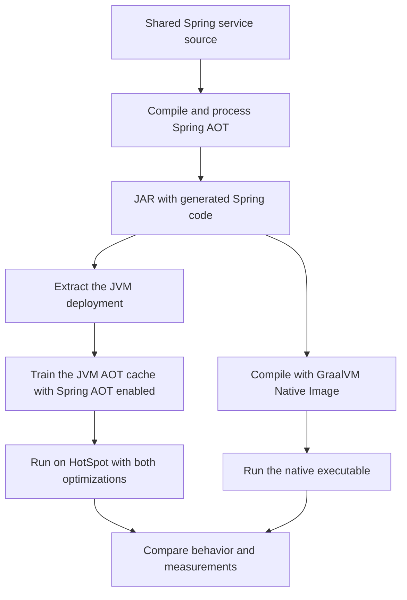

# Java AOT examples repository plan

Build a small repository of independently runnable examples that demonstrate three different meanings of ahead of time (AOT), run each against a baseline, and produce reproducible measurements. Include plain Java applications, Spring Boot service variants, and a final combined comparison of two optimized deployments of the same service. Each example can be selected directly through Docker Compose.

The final example covers all three technologies through two execution paths: **Spring AOT plus the JVM AOT cache**, and **Spring AOT plus GraalVM Native Image**. A native executable does not run on HotSpot, so it cannot also use HotSpot's AOT cache. These paths let us compare the available combinations without presenting an unsupported three-way runtime stack. [Spring JVM AOT documentation](https://docs.spring.io/spring-boot/reference/packaging/aot.html), [Spring Native Image introduction](https://docs.spring.io/spring-boot/reference/packaging/native-image/introducing-graalvm-native-images.html).

## What each technology does

| Technology | Work moved before deployment | Build artifact | Execution model |
| --- | --- | --- | --- |
| JVM AOT cache | Loading and linking classes; Java 25 also preserves method profiles to help JIT warmup | An application-specific `.aot` cache alongside the application | HotSpot JVM, with JIT compilation still available |
| Spring AOT | Discovering bean definitions and generating application initialization code and runtime hints | Generated Java, bytecode, and metadata included in the application | Either a JVM or a native executable |
| GraalVM Native Image | Analyzing reachable application code and compiling it to machine code | An executable for a particular OS and CPU architecture | A native runtime with its own garbage collection; no HotSpot JVM required |

The JVM examples will use Java 25's AOT cache, which builds on the class loading and linking work introduced in Java 24. It retains a JVM and JIT compiler; it is not equivalent to compiling the whole application into a standalone executable. [Oracle Java team's AOT cache explanation](https://inside.java/2026/01/09/run-aot-cache/).

Spring AOT can be enabled on the JVM independently of Native Image. Its bean graph is determined during the build, which changes how profiles and conditions that decide whether beans exist behave. [Spring Framework AOT documentation](https://docs.spring.io/spring-framework/reference/core/aot.html).

GraalVM also provides a JVM with the Graal JIT compiler. The examples will identify whether they use JVM mode or Native Image. [Graal compiler documentation](https://www.graalvm.org/latest/reference-manual/java/compiler/).

## Toolchain and initial scope

Use Java 25, Spring Boot 4.1.1, GraalVM Community 25, and Gradle with a checked-in wrapper in every example. These are compatible starting versions; pin the exact JDK distributions, patch releases, build plugins, Python dependencies, and container image digests when implementing. Spring Boot 4.1.1 supports Java 25 and GraalVM 25. [Spring Boot system requirements](https://docs.spring.io/spring-boot/system-requirements.html).

Make Docker Compose the main way to build and run the examples. Compose builds use pinned toolchain images, so Java, Gradle, and GraalVM do not need to be installed on the host. A `make status` command should check Docker, Compose, the target architecture, and the resources available for native compilation. Validate AOT flags and the native compiler toolchain inside the build images.

For optional local execution, use separate `HOTSPOT_JAVA_HOME` and `GRAALVM_JAVA_HOME` settings so switching tools is explicit. Keep the same HotSpot installation for every JVM comparison.

Support macOS for local development and a documented Linux environment for measurements with consistent CPU and memory limits. Compare results within one OS and architecture. Run Linux native executables against Linux JVM processes; publish macOS results separately.

Keep the first service self-contained: in-memory data, deterministic inputs, and no external database. Add persistence only after the initial comparisons work.

## Docker Compose workflow

Each numbered example owns a `compose.yaml` with the application services and profiles it needs. The root Makefile invokes the Compose file for the selected example. All Spring variants expose the same application on port 8080; stop the active profile before starting another. [Docker Compose profiles](https://docs.docker.com/compose/how-tos/profiles/).

Give the plain Java examples separate `cli-baseline`, `cli-jvm-cache`, and `cli-native` services and profiles. These run a fixed calculation and exit after printing a checksum. Each example README specifies its Compose command and benchmark command.

The planned commands are:

```sh
# Start the standard JVM example
docker compose --profile baseline up --build

# Stop it before switching examples
docker compose --profile baseline down

# Build and start Spring AOT plus GraalVM Native Image
docker compose --profile native up --build

# Stop the native example
docker compose --profile native down
```

Build application artifacts, train caches, and compile native executables in Linux build stages for the same architecture as their runtime images. Package each JVM cache with its matching extracted application and JVM. Use smaller runtime stages for execution; keep native compilation out of startup measurements.

Apply identical application CPU and memory limits using Compose service settings, and define readiness health checks. A separate load-generator service runs on the Compose network. [Compose service settings](https://docs.docker.com/reference/compose-file/services/).

`make compare` should prepare the images, then run the variants one at a time through Compose and export raw results and the report to the host. The host benchmark orchestrator controls Compose and starts the load-generator service. Keep Compose/container launch-to-readiness timing separate from application process-to-readiness timing; use direct HTTP probes for startup measurements rather than the health-check interval.

Record Docker and Compose versions, image digests, and Docker Desktop VM resources with the results. On macOS, these are Linux container measurements; keep them separate from direct macOS execution. Validate the Compose configuration before building and smoke-test every profile during implementation.

## Runnable examples

| Example | Application mode | What it demonstrates and measures |
| --- | --- | --- |
| `01-plain-java` | Plain Java on HotSpot | Standard bytecode execution, CLI completion time, and memory use. |
| `02-plain-jvm-aot-cache` | Plain Java with JVM AOT cache | Cache training and reuse; completion time and memory compared with the plain JVM baseline. Include short and workload training recipes. |
| `03-plain-graalvm-native` | Plain Java with GraalVM Native Image | Native execution of the same CLI; completion time, memory, build cost, and deployment size compared with the plain JVM baseline. |
| `04-spring-java-baseline` | Spring Boot on HotSpot | Standard HTTP service execution, readiness, first useful response, memory, and request performance. |
| `05-spring-aot-cache` | Spring AOT on HotSpot | Generated Spring initialization code; startup and runtime measurements compared with the Spring JVM baseline. |
| `06-spring-jvm-aot-cache` | Spring Boot with JVM AOT cache | JVM cache contribution with Spring AOT disabled, using the same service and workload. |
| `07-spring-aot-graalvm-native` | Spring AOT with GraalVM Native Image | Native execution of the same service, including JSON, resources, and reflection metadata; the same startup and runtime measurements. |
| `08-spring-aot-jvm-aot-cache` | Spring AOT with the JVM AOT cache | Combined JVM execution compared with its ordinary baseline; no native compilation. |
| `09-combined-comparison` | Combined JVM and native deployments | Spring AOT plus JVM AOT cache, compared with Spring AOT plus Native Image and the individual variants; a generated report for the complete matrix. |

Put each example in an ordered `examples/NN-name/` directory. That directory owns its README, application source, Gradle wrapper and configuration, Compose file, container recipes, and tests. The root `benchmark/` directory owns the shared measurement and reporting harness; the root `results/NN-name/` directory receives its generated evidence and is permanently ignored by Git. Each README should state the purpose, build/run/stop commands, expected output, configuration, benchmark command, and measured results. Include relevant generated artifacts and tradeoffs in the explanation. Every variant runs independently through its own Compose configuration. Reproduce a fixed workload contract in every example so comparisons change execution strategy rather than business behavior.

The CLI examples provide a minimal Java workload and their own comparison group. Use the Spring JVM baseline for comparisons involving the HTTP service.

## Comparable application contract

Implement a small product catalog and price calculator in each example. The CLI executes a fixed request set and prints a deterministic checksum. The Spring service exposes:

- `GET /ready`: returns success after the application and fixture data are ready.
- `GET /products/{id}`: exercises routing, dependency injection, and JSON serialization.
- `POST /quotes`: validates input and calculates a deterministic quote.
- `GET /compute?iterations=...`: exercises bounded CPU work so warmup and sustained execution are visible. Consume and return the result to prevent unused work from disappearing.

Use small and larger fixtures with fixed seeds. Avoid artificial sleeps and inflated bean counts. Add an optional larger Spring configuration later if we want to study how application size changes startup gains.

The plain native CLI includes its catalog resource through Native Image reachability metadata and verifies the embedded data before measurement. The Spring native example includes a reflection fixture with the required Spring `RuntimeHints` documented alongside it. Cover missing metadata with a diagnostic test there; keep the benchmark application functional in every mode.

## Final comparison matrix

Run these five variants with equivalent Spring service source copied into each standalone example:

| Variant | Runtime | Spring AOT | Application JVM AOT cache |
| --- | --- | --- | --- |
| JVM baseline | HotSpot Java 25 | Off | Off |
| JVM cache | HotSpot Java 25 | Off | On |
| Spring AOT | HotSpot Java 25 | On | Off |
| Combined JVM | HotSpot Java 25 | On | On |
| Spring native | GraalVM Native Image | On | Not applicable |

The first four rows form a two-by-two experiment: they show each feature's individual contribution and the effect of combining them. The native row compares the complete deployment alternative. Spring AOT is part of the supported Spring Native Image build, so a native row with Spring AOT disabled is not part of this matrix. [Spring Framework AOT execution documentation](https://docs.spring.io/spring-framework/reference/core/aot.html).

For the four JVM rows, use the same AOT-processed JAR with Spring AOT switched on or off, and the same extracted deployment layout. Keep ordinary JVM defaults, including default CDS, in the baseline. Train separate caches for the Spring AOT enabled and disabled configurations.

The combined example should use this build and execution flow:



Optional extensions after the core matrix: add GraalVM JVM mode as a distinct control, and add native profile-guided optimization (PGO). Check the selected distribution's JVM cache compatibility before attempting a Graal JIT plus cache combination. Native PGO requires an edition that provides it; current documentation excludes GraalVM Community Edition. [GraalVM PGO documentation](https://www.graalvm.org/latest/reference-manual/native-image/optimizations-and-performance/PGO/).

## JVM cache workflow

For Java 25, generate the cache using `-XX:AOTCacheOutput=...` and consume it using `-XX:AOTCache=...`. For a Spring executable JAR, first extract it with Boot's tools mode and use that extracted application for both training and measurements. [Spring Boot AOT cache instructions](https://docs.spring.io/spring-boot/reference/packaging/aot-cache.html).

Provide two training strategies. A startup-only run exits when the Spring context is refreshed. A workload run starts the service, sends representative requests through every benchmark endpoint, then shuts down cleanly so the cache can be generated. The latter also exercises method profiling. Regenerate caches when the application or JVM changes. Preserve the classpath ordering and JAR timestamps. Verify cache use with strict AOT mode and diagnostic logs before timing runs. [Spring Framework JVM cache guidance](https://docs.spring.io/spring-framework/reference/integration/aot-cache.html), [Oracle Java team's cache workflow](https://inside.java/2026/01/09/run-aot-cache/).

The combined variant must enable Spring AOT during both training and execution. Treat each cache and its application build as one deployment unit.

## Measurements and benchmark method

| Measurement | Definition |
| --- | --- |
| CLI completion | Monotonic time from process launch until successful exit; verify checksum afterward |
| HTTP readiness | Time from application process launch to a successful `/ready` response |
| First useful response | Time from process launch to a verified product or quote response |
| Early request performance | Latency and successful requests per second in fixed intervals immediately after readiness |
| Steady request performance | Successful requests per second, p50/p95/p99 latency, and errors after a declared warmup period |
| Memory | Process RSS at readiness, idle, and steady load; peak RSS with the collection method recorded |
| Preparation cost | Packaging, Spring processing, cache training/assembly, and native compilation time and peak memory |
| Deployment size | Application files, cache, executable, and total runtime distribution or container size reported separately |

Build a Python orchestrator that launches a variant, checks responses, collects measurements, terminates its processes, and writes raw records. Use a pinned load generator in a separate process for HTTP performance; do not use the readiness polling loop as a throughput benchmark.

Start with 30 fresh process launches per variant and five independent load repetitions. Use a seeded, randomized variant order. Give the client identical polling intervals and record that interval as startup measurement uncertainty. Label these as fresh-process starts with an ordinary OS page cache; do not describe them as disk-cold starts.

For load tests, use a declared offered request rate to compare latency fairly, then a separate concurrency sweep to compare sustained capacity. Start with a 30-second warmup and 60-second measurement window; lengthen warmup if interval traces still drift. Report early request traces separately so a fixed warmup does not hide improvements there. Check that the load generator has capacity beyond the server's measured throughput.

Fix the dataset, endpoint mix, connection reuse, CPU and memory limits, and logging level. Record JVM/native GC and heap settings rather than assuming they are equivalent. Keep profiling and verbose class-loading logs out of timed runs. Separate preparation costs from runtime gains, and label whether dependency downloads were included in build timings.

Verify responses and checksums in every mode before benchmarking. Stop a benchmark when cache verification or functional checks fail. Record failed launches, timeouts, HTTP errors, and resource-limit failures; a broken or skipped variant must not appear as a fast result.

Store one record per run with the source revision, artifact checksum, command, exact Java/native versions, CPU, OS, architecture, resource limits, training recipe, and measurements. Produce JSON/CSV for analysis and a static HTML report with plots and raw-data links. Show medians and spread across repetitions alongside percentages; report startup p95 as descriptive with its sample count.

For lower-is-better metrics, calculate reduction as `100 * (baseline - variant) / baseline`. For throughput, calculate gain as `100 * (variant - baseline) / baseline`. Show absolute values as well. Negative improvements are valid results; the native deployment may improve startup without winning sustained throughput.

## Proposed repository layout

```text
aot-examples/
  README.md
  Makefile                      # Root entry point for the implemented example
  examples/
    01-plain-java/              # Fully independent Java CLI example
      build.gradle, settings.gradle, gradlew, gradlew.bat, gradle/
      compose.yaml
      containers/
      src/
    02-plain-jvm-aot-cache/         # Independent source, wrapper, Compose, and containers
      containers/
    03-plain-graalvm-native/            # Independent source, wrapper, Compose, and containers
      containers/
    04-spring-java-baseline/     # Independent source, wrapper, Compose, and containers
      containers/
    05-spring-aot-cache/              # Independent source, wrapper, Compose, and containers
      containers/
    06-spring-jvm-aot-cache/        # Independent source, wrapper, Compose, and containers
      containers/
    07-spring-aot-graalvm-native/           # Independent source, wrapper, Compose, and containers
      containers/
    08-spring-aot-jvm-aot-cache/ # Independent combined JVM service
    09-combined-comparison/     # Independent five-mode comparison suite
      containers/
  benchmark/                    # Shared runners, checks, statistics, and reports
  results/                      # Ignored generated evidence, grouped by example number
  .gitignore                    # Build output, caches, binaries, and routine runs
```

Keep generated Java sources in the build directories and document where to find them. All generated benchmark evidence and reports belong under the Git-ignored root `results/` directory and must never be committed. READMEs may describe observed measurements and commands to regenerate them. Ignore compiled artifacts and local caches.

## Implementation milestones

1. **Foundation and baseline:** add the standalone wrapper, workload, CLI, Spring service, baseline Dockerfile and Compose profile, correctness checks, and environment checks to their respective examples. Complete when both applications produce deterministic results, the Spring baseline starts through Compose, and the harness measures it without leaving processes running.
2. **JVM cache examples:** implement CLI and Spring training, extraction, strict cache verification, and startup/workload recipes. Complete when each cache is demonstrably used and invalid-cache checks prevent misleading measurements.
3. **Spring AOT example:** add the build step, generated-code explanation, and JVM toggle. Complete when the baseline and Spring AOT modes return identical responses and tests verify build-time profile selection.
4. **Native examples:** build the CLI and Spring service as native executables, add the working runtime-hints fixture, and run the same functional suite against both. Complete when every benchmark endpoint works in native mode.
5. **Combined comparison:** train the Spring AOT cache, add all five Compose profiles, run the matrix sequentially under consistent limits, and collect repeated measurements. Complete when every reported run includes its configuration and verification evidence.
6. **Example documentation and automation:** finish the application READMEs and comparison documentation, plots, result interpretation, and CI smoke checks. Complete when a reader can run any example directly and regenerate the comparison report from raw records.

Examples 01–09 are implemented. Example 08 runs Spring AOT plus its matching JVM cache and benchmarks that combination against its ordinary baseline. Example 09 is the five-mode comparison suite; `make test-app EXAMPLE=09` directs callers to `make bench EXAMPLE=09`, and the test-app picker excludes it. The root commands open an fzf example picker when `EXAMPLE` is omitted. Explicit numbers or full directory names bypass selection for scripts. Cache training and verification offer examples 02, 06, 08 and 09 only, and cancellation runs no commands. Example 02's `make bench` compares a fresh ordinary-JVM baseline against short and workload caches within its own image, without depending on example 01. It records cache verification, training cost, cache size, and runtime measurements under `results/02-plain-jvm-aot-cache/`. Example 03 compares its JVM and native CLI in the same benchmark image, records native compilation time/memory and artifact sizes, and checks the production native image runs without Java. Its evidence goes under `results/03-plain-graalvm-native/`.

Examples 04–06 own identical copied HTTP application source, resources and tests. Example 04 establishes the JVM baseline. Example 05 compares Spring AOT off/on in its same processed JAR, saves generated sources, and demonstrates build-time profile selection. Example 06 keeps Spring AOT disabled, trains context-refresh and real HTTP-workload JVM caches, verifies application-class archive use, and rejects a missing cache and same-path changed JAR. HTTP `make test-app` starts a detached service and waits for its health check, then verifies sample API requests; `PORT` selects the host port.

The implemented HTTP benchmark defaults to `SUITE=startup`: two unmeasured processes and 30 measured starts per mode, readiness and first useful responses, readiness/idle/peak application RSS, shuffled order, and 20 ms readiness polling. `SUITE=load` or `SUITE=all` adds a Python client in its own Compose container with one keep-alive connection at a declared offered rate (default five repetitions, 30-second warmup, 60-second measurement). Every response is verified. The client has two CPUs and 256 MiB memory, separate from the one-CPU application container and the report measures latency at the offered rate; concurrency/capacity sweeps, interval stability traces, early load windows, plots, and total distribution/container sizes remain future benchmark additions. All raw HTTP evidence and reports go under ignored root result directories for their respective examples.

Example 07 compiles Spring AOT output into a GraalVM native service, verifies JSON/resources/reflection and an intentional missing-hint diagnostic, and compares JVM/native startup and paced load. Example 08 owns separate ordinary and processed Gradle deployments and trains only the combined cache. Its default runtime combines Spring AOT with the JVM cache, and its benchmark compares two modes. Example 09 owns its independent source, ordinary/processed deployments, both matching caches and native executable, rejects mismatched deployments and compares all five supported modes without selecting a default application. Native production images run without Java. Shared root commands and reports cover all nine examples.

Current commands (omit `EXAMPLE` for fzf):

```sh
make status EXAMPLE=07
make build EXAMPLE=08
make train EXAMPLE=08
make verify EXAMPLE=08
make test-app EXAMPLE=08
make clean EXAMPLE=08
make bench EXAMPLE=08 SUITE=startup RUNS=30
make bench EXAMPLE=08 SUITE=all
make build EXAMPLE=09
make bench EXAMPLE=09 SUITE=all
```

Run fast correctness checks and JVM smoke checks on routine CI. Use a separate native build job. Run full performance comparisons manually or on a dedicated benchmark runner so shared CI noise does not become a claimed improvement.

The final report should answer four practical questions: how much earlier the application can serve useful requests, how much runtime memory it saves, what happens under sustained load, and what extra build and deployment work those gains require. Choose the preferred deployment from the measurements and the workload's priorities.
